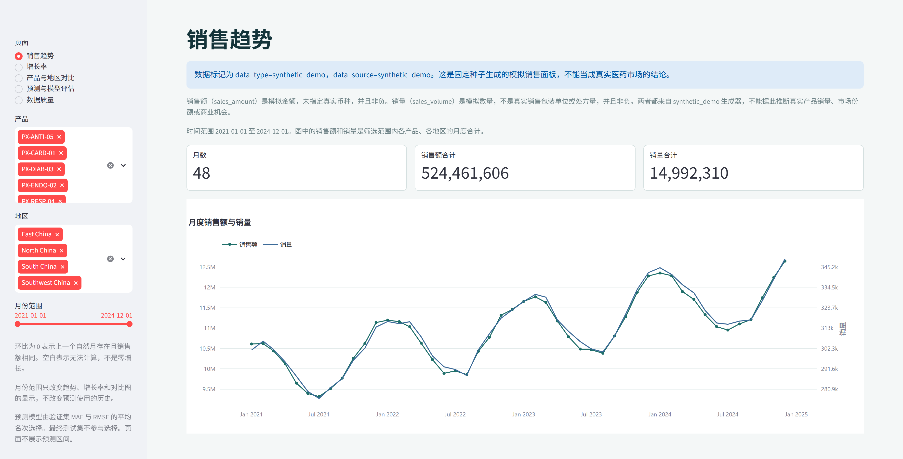
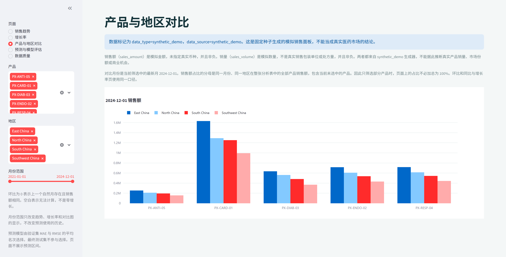
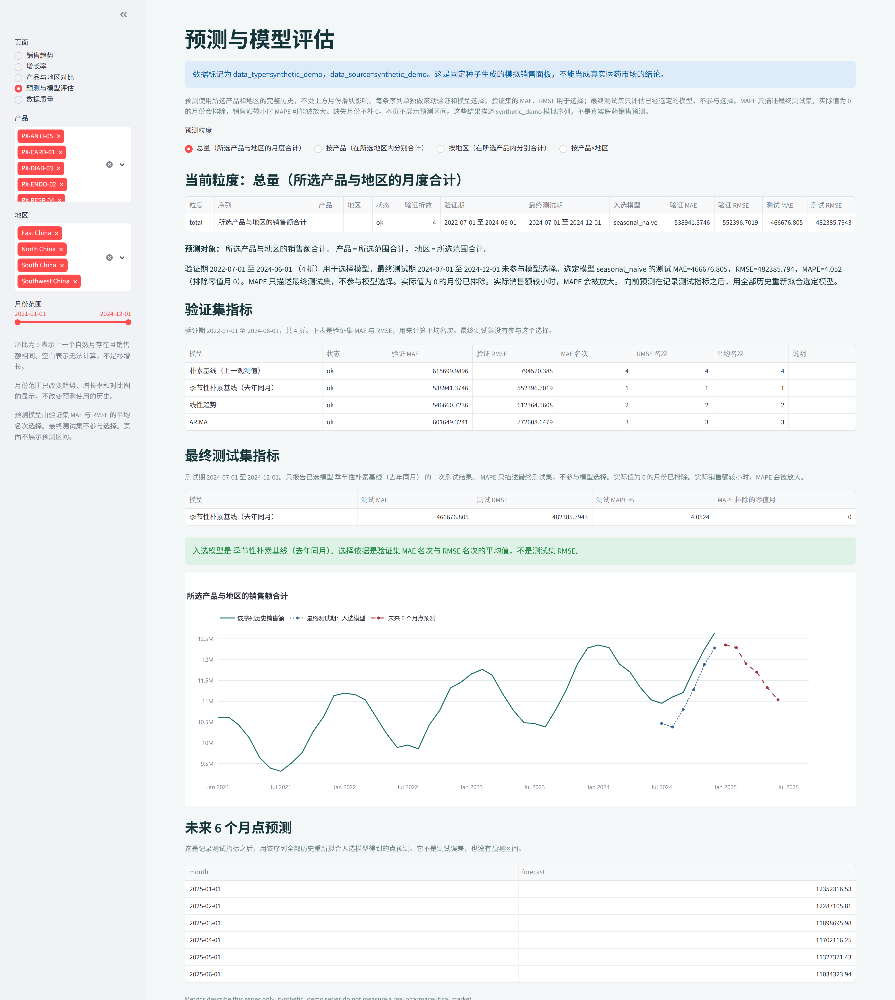
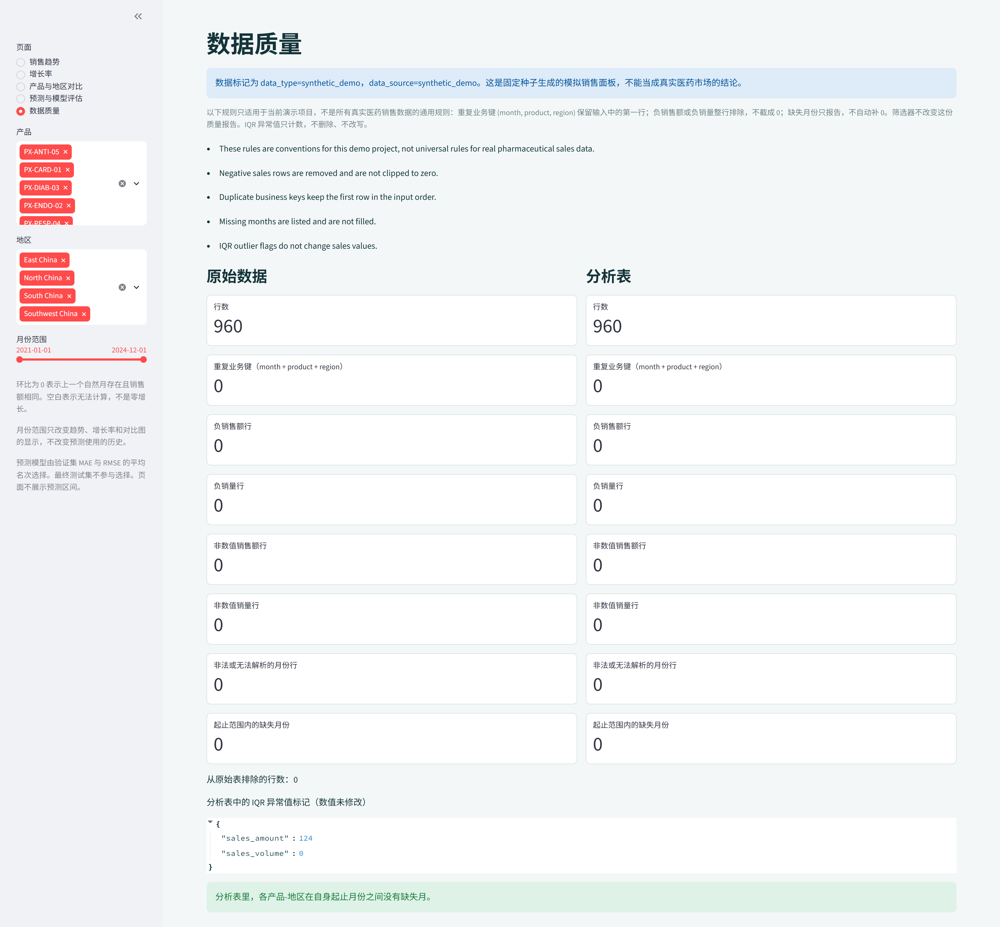

# Pharmaceutical Sales Analytics & Forecasting Platform

月度医药销售分析与预测平台。当前数据是固定种子生成的模拟面板，产品编号和地区名称都是虚构标签。页面上的差异只描述这条模拟序列，不是真实医药市场结论。

## 五个页面

启动后侧边栏有五个页面，并可以按月份、产品和地区筛选。数据质量页展示的是整份文件，不受筛选器影响。

1. **销售趋势**：筛选范围内的月度销售额合计与销量合计、时间范围，以及一张双轴趋势图。
2. **增长率**：环比是本月相对上一自然月；同比是本月相对去年同月。对比月缺失或分母为 0 时显示“无法计算”，不把缺失月当成 0，也不把无法计算显示成 0% 增长。页面同时给出各产品从首次出现月份到末次出现月份的销售额 CAGR。
3. **产品与地区对比**：最新筛选月份的销售额、销量、销售额占比、环比和同比。销售额占比是该产品销售额除以同一月份、同一地区的产品销售额合计。
4. **预测与模型评估**：可选总量、按产品、按地区或按产品×地区。每条序列用各自的完整历史做滚动验证并选择模型，再在最后 6 个日历月上做一次测试。月份滑块不改变这条历史。不展示预测区间。
5. **数据质量**：原始文件与排除非法行之后的分析表分开计数。检查缺失值、重复业务键、非法日期、非数值、负值和月份缺口。IQR 异常值只标记，不删除、不改写。

## 界面

下面四张图是当前应用在 `synthetic_demo` 模拟面板上的实际页面，不是真实医药销售结果。

销售趋势页展示全部产品和地区的月度销售额、销量，以及合计指标。



产品与地区对比页展示 2024-12 各产品在四个地区的模拟销售额。



预测页以总量粒度同时给出验证集指标、最终测试集指标、入选模型和未来 6 个月点预测。图中没有预测区间。



数据质量页并列展示原始表和分析表的行数、重复键、负值、缺失月，以及只标记、不改写的 IQR 计数。



指标口径：

- `sales_amount` 是模拟金额，未指定真实币种，非负。
- `sales_volume` 是模拟数量，不是真实销售包装单位或处方量，非负。
- 业务键是 `month + product + region`。`month` 必须是月初 `YYYY-MM-01`。
- 销售额占比的分母是同一月份、同一地区在整张分析表中的全部产品销售额。只筛选部分产品时，页面上的占比不必加总为 100%。
- CAGR 是当前筛选时间范围内，从首个出现月份到最后出现月份的年化增长率，不是固定自然年度的增长率。
- 重复键保留第一行、负销售额或负销量整行排除、缺失月份只报告不补 0，是当前演示项目的处理约定，不是所有真实医药数据的通用规则。

## 技术栈

Python 3.10+、pandas、NumPy、SciPy、statsmodels（ARIMA）、Streamlit、Plotly、PyYAML、pytest。不调用外部 API。

## 数据

唯一原始输入是 `data/raw/pharma_sales_monthly_synthetic.csv`。

- 生成命令：`python scripts/generate_pharma_data.py`
- 配置：`config/pharma_settings.yaml`，种子 42
- 网格：2021-01 至 2024-12，5 个虚构产品，4 个虚构地区，共 960 行
- 每行 `data_type=synthetic_demo`，`data_source=synthetic_demo`
- 字段说明：`data/metadata/PHARMA_DATA_NOTES.md` 与 `data/metadata/pharma_data_dictionary.csv`

生成器不读取其他 CSV。负销售额和负销量会从分析表排除，不截成 0。重复键保留输入中的第一行。缺失月份只报告，不补 0。这三项是本演示的约定。模拟序列上的差异不能解释成真实市场份额或商业机会。

## 安装与启动

在仓库根目录：

```bash
python -m venv .venv
```

Windows PowerShell：

```powershell
.\.venv\Scripts\Activate.ps1
python -m pip install -r requirements.txt
python scripts/generate_pharma_data.py
python scripts/run_pharma_pipeline.py
streamlit run dashboard/app.py
```

`scripts/run_pipeline.py` 与 `scripts/run_pharma_pipeline.py` 是同一个医药流水线。它写出：

- `data/processed/pharma_sales_monthly_clean.csv`
- `data/processed/pharma_data_quality_report.json`
- `database/pharma_analytics.db`（表 `pharma_sales_monthly`）
- `reports/pharma/forecast_total.json`

仪表盘直接读取原始 CSV 并在内存中做同样的校验，不依赖上面的导出文件才能打开。

## 测试

在仓库根目录：

```bash
python -m pytest tests -q --tb=short
```

## 目录

```text
dashboard/app.py                 Streamlit 入口
dashboard/data_service.py        读取、筛选、合计与预测缓存
src/config.py                    读取 config/pharma_settings.yaml
src/pharma_schema.py             字段契约与模拟公式
src/pharma_quality.py            原始画像、排除规则、分析表
src/pharma_features.py           环比、同比、占比、CAGR
src/pharma_forecast.py           按时间切分的预测评估
src/data_dictionary.py           字段字典读取
scripts/generate_pharma_data.py  生成 synthetic_demo CSV
scripts/run_pharma_pipeline.py   清洗、入库、写出预测报告
config/pharma_settings.yaml
data/raw/pharma_sales_monthly_synthetic.csv
data/processed/
data/metadata/
database/pharma_analytics.db
reports/pharma/forecast_total.json
tests/
```

## 预测评估与局限

预测可以按四条口径分别进行，每条序列单独排序、验证和评估，不会把不同产品或地区的时间序列放进同一个模型：

- **总量**：所选产品与地区的月度销售额合计。流水线写出的 `reports/pharma/forecast_total.json` 使用这一口径。
- **按产品**：每个所选产品一条序列，金额是该产品在所选地区内的月度合计。
- **按地区**：每个所选地区一条序列，金额是该地区在所选产品内的月度合计。
- **按产品×地区**：每个产品与地区组合一条序列。

月份滑块只改变趋势、增长率和对比页的显示范围。预测使用所选实体的完整可用历史。

- 最终测试集是该序列最后 6 个日历月。它不参与模型选择。
- 在测试集之前做滚动验证：初始训练至少 18 个月，预测步长 6 个月，每 6 个月滚动一次。验证窗必须在最终测试期之前结束。
- 历史不足以形成至少一个验证折时，状态为 `insufficient_history`。不会改用最终测试集来选模型。
- 选择指标是验证集 MAE 与 RMSE 的平均名次。平局时优先朴素基线、季节性朴素、线性趋势、ARIMA。
- 模型选定后，才报告该模型在最终测试集上的 MAE、RMSE。MAPE 只作描述，并记录排除的零值月；实际销售额较小时 MAPE 可能被放大。
- 朴素基线重复训练期最后一个观测值。季节性朴素模型只在训练期不少于 12 个月且能找到去年同月时参与比较。
- 线性趋势按日历月序号拟合。序列内部有缺口时，不把后面的观测前移成连续月份。
- ARIMA 按固定顺序尝试 `(1,1,1)`、`(1,1,0)`、`(0,1,1)`，只在训练期上拟合。训练期内有缺失月时不把观测序号当成连续月份，该折标记失败。没有用测试集选择阶数。
- 测试指标记录之后，用该序列的全部历史重新拟合入选模型，给出之后 6 个月的点预测。
- 不提供预测区间。结果里的 `intervals` 为空。
- 缺失月只给出警告，不填成 0。全 0 序列可以计算点误差，但 MAPE 不能解释为预测性能。

这些数字只描述模拟序列。

## 后续可以做的事

- 在有授权和字段说明之后接入 `data_type=real` 的月度销售表。接入时要重新确认去重、负值和缺失月规则，不能直接把演示约定当成通用业务规则。
- 在单独的验证设计下补充预测区间，而不是用未检验的区间填图。
