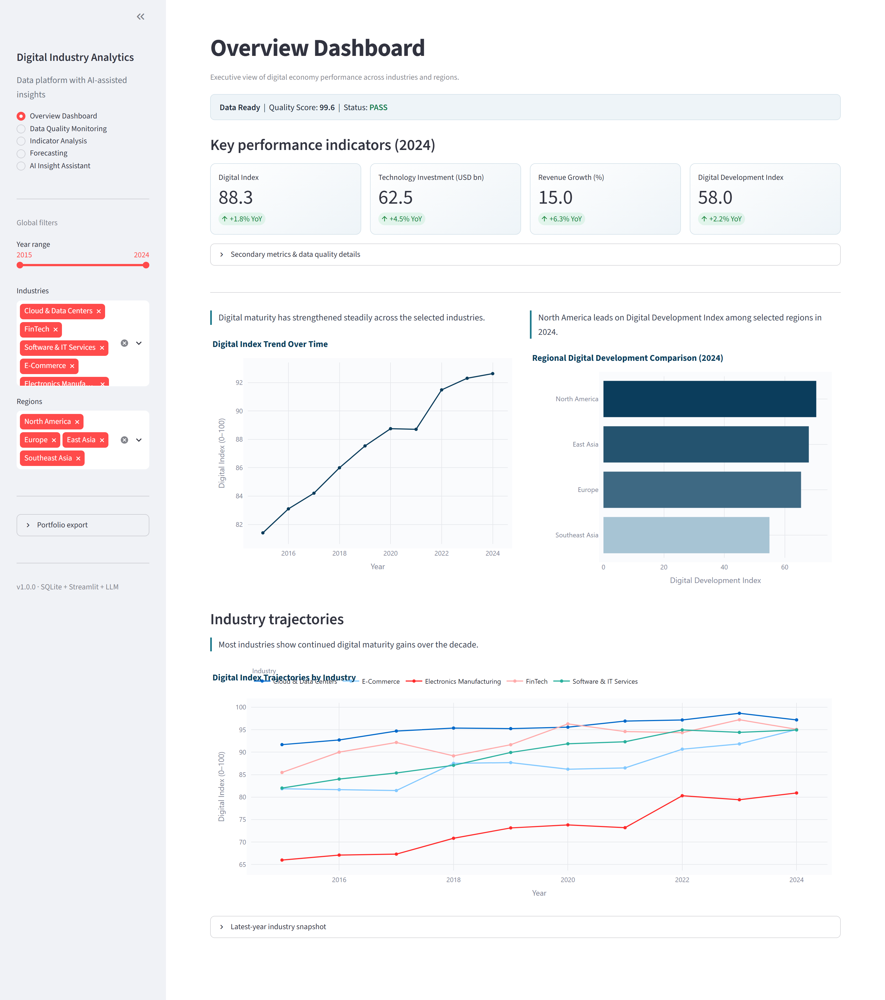
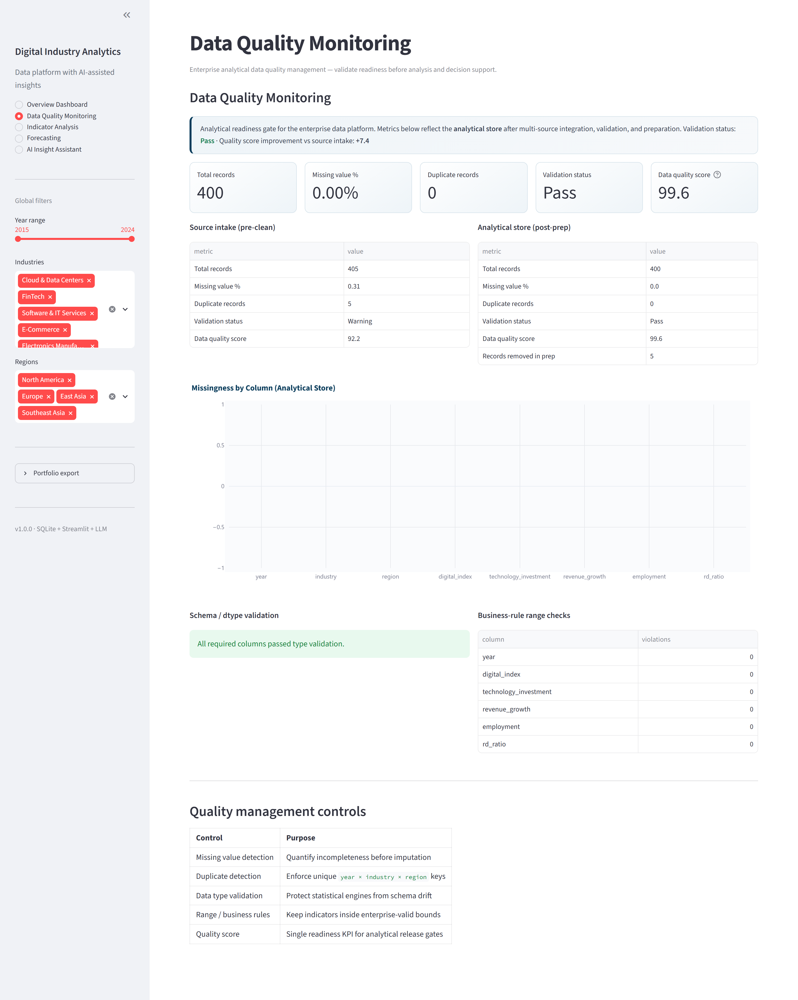
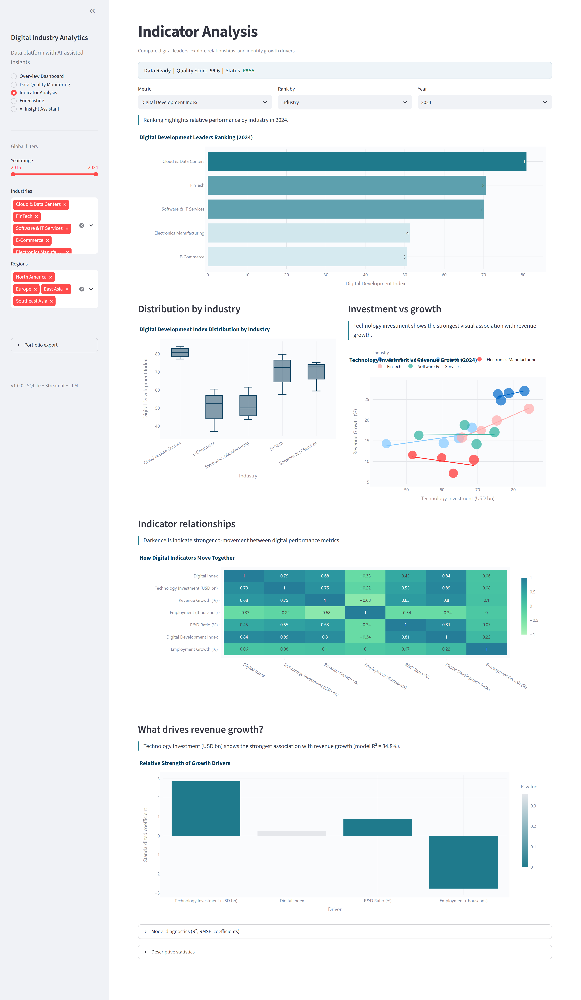
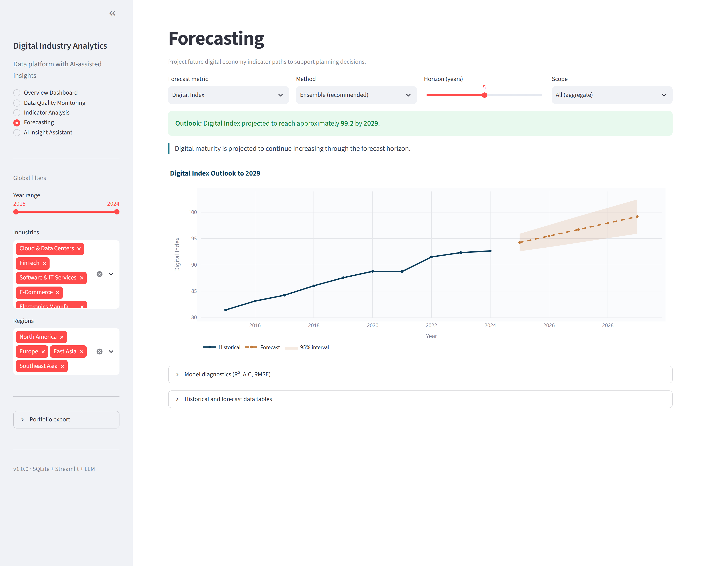
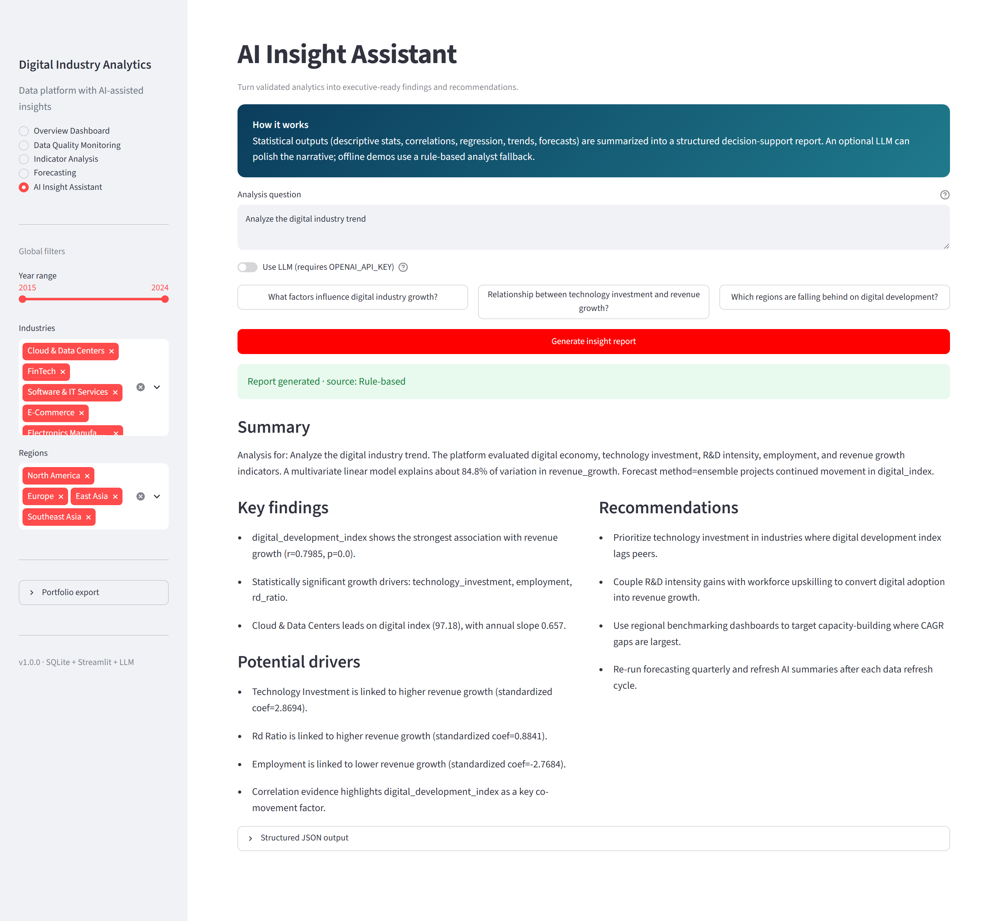

# Digital Industry Analytics Platform with AI-assisted Insights

An **enterprise analytical data platform** for digital-industry decision support. It integrates multi-source economic, industry, and technology datasets into a governed analytics layer—covering data preparation, quality validation, indicator engineering, statistical analysis, and interactive reporting—so analysts and stakeholders can move from raw indicators to evidence-based decisions.

Optional LLM-assisted narrative generation can summarize validated analytical outputs; it augments the workflow and does not replace statistical methods or data controls.

Built as a **Senior Digital Data Analyst** portfolio prototype: modular, reproducible, and runnable end-to-end without external AI services.

---

## Project overview

| Layer | Capability |
|-------|------------|
| Multi-source integration | Ingest digital economy, technology investment, employment, and R&D indicator sources into a unified panel |
| Analytical data preparation | Cleaning, type coercion, imputation, feature/indicator engineering, SQLite persistence |
| Data quality validation | Missing values, duplicates, dtype checks, range rules, outlier screening, quality reports |
| Statistical analytics | Descriptive statistics, correlation, OLS regression, trend analysis, time-series forecasting |
| Decision support | KPI dashboards, rankings, scenario-ready forecasts, structured findings for planning |
| Narrative enhancement (optional) | LLM or rule-based summaries grounded in computed analytics results |

---

## Business problem

Digital transformation investment is uneven across industries and regions. Organizations need a reliable analytical workspace—not a one-off chart pack—to integrate fragmented indicator sources, assure data quality, and support planning decisions such as:

1. Where is digital development accelerating or stalling?
2. Which measurable factors are most associated with industry revenue growth?
3. How might digital economy indicators evolve over the next 3–5 years under current trends?
4. What actions are supported by the statistical evidence?

This platform prepares multi-source panel data into governed analytical assets, produces statistical evidence and forecasts, and surfaces them through decision-support dashboards. AI-generated narrative, when enabled, helps communicate those results—it does not drive the analysis.

---

## Architecture

```text
┌─────────────────────────────────────────────────────────────────┐
│              Decision-Support Dashboard (Streamlit)              │
│  Overview · Indicator Analysis · Forecasting · Insight Assist.   │
└─────────────┬───────────────────────────────────────────────────┘
              │
              ▼
┌──────────────────────────┐     optional narrative enhancement
│   Analytics Services      │────────────────────────────────┐
│  stats · regression       │                                ▼
│  forecasting · indicators │              ┌──────────────────────────────┐
└─────────────┬────────────┘              │  LLM / rule-based summary     │
              │                            │  (grounded in analytics only) │
              ▼                            └──────────────────────────────┘
┌──────────────────────────┐    ┌──────────────────────────────┐
│   Analytical Data Prep    │───▶│   Analytical Store            │
│  integrate → validate     │    │  SQLite (analytics.db)       │
│  clean → enrich           │    │  data/processed · reports    │
└─────────────┬────────────┘    └──────────────────────────────┘
              │
              ▼
     Multi-source raw inputs
   (digital economy, tech investment,
    employment, R&D indicators)
```

---

## Repository structure

```text
digital_industry_analytics/
├── data/
│   ├── raw/                 # Source CSVs
│   ├── processed/           # Cleaned / enriched outputs
│   └── metadata/            # Data dictionary & metadata docs
│       ├── data_dictionary.csv
│       └── DATA_DICTIONARY.md
├── database/
│   └── analytics.db         # SQLite store (created by pipeline)
├── src/
│   ├── config.py            # Settings + .env loader
│   ├── data_loader.py       # CSV + SQLite I/O
│   ├── data_cleaning.py     # Validation & quality reports
│   ├── data_dictionary.py   # Metadata catalog loader
│   ├── indicator_engine.py  # Normalize, growth, CAGR, DDI
│   ├── analytics.py         # Stats, correlation, regression
│   ├── forecasting.py       # Linear trend / ARIMA / ensemble
│   └── llm_summary.py       # LangChain insight generation
├── dashboard/
│   ├── app.py               # Multi-page Streamlit app
│   ├── data_service.py      # Cached data access layer
│   └── export_utils.py      # Chart/table PNG export helpers
├── notebooks/               # Exploratory analysis notebook
├── reports/
│   ├── screenshots/
│   │   ├── overview.png
│   │   ├── data_quality.png
│   │   ├── indicators.png
│   │   ├── forecasting.png
│   │   └── ai_insight.png
│   └── *.json               # Pipeline analytics snapshots
├── config/settings.yaml     # Project configuration
├── scripts/
│   ├── generate_sample_data.py
│   ├── run_pipeline.py
│   └── export_portfolio_charts.py
├── requirements.txt
├── .env.example
└── README.md
```

---

## Data pipeline

1. **Ingest** — Load panel CSV (`year`, `industry`, `region`, digital & economic indicators).
2. **Quality** — Detect missing values, duplicates, dtype issues, range violations, IQR outliers; emit JSON quality report.
3. **Clean** — Coerce types, drop duplicate keys, impute via industry–region medians, clip to business bounds.
4. **Enrich** — Employment growth, normalized components, composite **Digital Development Index**.
5. **Persist** — Write `data/processed/` + SQLite `industry_indicators`.
6. **Analyze** — Snapshot descriptive / correlation / regression results to `reports/`.

### Digital Development Index (DDI)

Digital Development Index:

DDI = 100 × Σ(weight × normalized indicator)

Default weights (`config/settings.yaml`):

| Component | Weight |
|-----------|--------|
| Technology investment | 0.30 |
| Digital adoption (`digital_index`) | 0.25 |
| R&D intensity (`rd_ratio`) | 0.25 |
| Employment growth | 0.20 |

---

## Analytics methodology

| Method | Purpose |
|--------|---------|
| Descriptive statistics | Distribution, skewness, kurtosis of indicators |
| Pearson correlation | Pairwise association; heatmap in dashboard |
| Target correlation ranking | Features vs `revenue_growth` with p-values |
| OLS linear regression (standardized) | Drivers of revenue growth (R², RMSE, significance) |
| Linear trend forecast | Extrapolate annual means with prediction intervals |
| ARIMA(1,1,1) | Short-horizon stochastic forecast (statsmodels) |
| Ensemble | Average of linear + ARIMA projections |

**Example questions the modules target**

- What factors influence digital industry growth?
- What is the relationship between technology investment and revenue growth?

---

## Narrative enhancement (optional AI)

AI is an optional layer on top of validated analytics—not the core of the platform. `src/llm_summary.py` packages statistical and forecast outputs into a context pack, then:

1. Optionally invokes a LangChain chat model (`langchain-openai` / OpenAI-compatible) to draft an executive narrative.
2. Returns a fixed decision-support schema:

```json
{
  "summary": "...",
  "key_findings": ["..."],
  "drivers": ["..."],
  "recommendations": ["..."]
}
```

3. If no API key is configured (or the call fails), a **rule-based summarizer** fills the same schema from coefficients and correlations, so decision-support demos remain offline-capable.

---

## Dashboard pages

| Page | Contents |
|------|----------|
| **Overview** | Compact data-ready status, 4 primary KPIs, Digital Index trend, regional & industry views |
| **Data Quality** | Intake vs analytical-store monitoring, validation status, quality score |
| **Indicator Analysis** | Leaders ranking, distributions, investment–growth relationship, correlations, drivers |
| **Forecasting** | Outlook statement, forecast path with confidence band, diagnostics in expanders |
| **Insight Assistant** | Optional narrative over analytics outputs → structured decision-support report |

---

## Screenshots

Portfolio visuals live in [`reports/screenshots/`](reports/screenshots/). After you capture the Streamlit UI (see below), GitHub will render these images in the README.

### Overview Dashboard



### Data Quality Dashboard



### Indicator Analysis



### Forecasting Dashboard



### AI Insight Assistant



---

## How to capture screenshots for the portfolio

Use these steps so the README images above display correctly on GitHub.

### 1. Run the app

```bash
cd digital_industry_analytics
streamlit run dashboard/app.py
```

Open `http://localhost:8501`. Prefer a wide browser window (≈1440px+) for cleaner captures.

### 2. Capture each page

| README file | Sidebar page | What to show in frame |
|-------------|--------------|------------------------|
| `reports/screenshots/overview.png` | Overview Dashboard | Quality metrics + KPI cards + at least one trend chart |
| `reports/screenshots/data_quality.png` | Data Quality Monitoring | Scorecards + intake vs analytical-store comparison |
| `reports/screenshots/indicators.png` | Indicator Analysis | Ranking chart + correlation heatmap |
| `reports/screenshots/forecasting.png` | Forecasting | Historical + forecast chart with interval band |
| `reports/screenshots/ai_insight.png` | AI Insight Assistant | Generated summary / findings / recommendations |

**Windows:** `Win + Shift + S` (Snipping Tool) or Win + Print Screen  
**macOS:** `Cmd + Shift + 4`  
**Chrome:** DevTools → Ctrl/Cmd+Shift+P → “Capture full size screenshot” (good for long pages)

Save/export as PNG using **exactly** the filenames in the table (lowercase, underscores).

### 3. Automated full-page capture (recommended)

With the dashboard running on `http://localhost:8501`:

```bash
pip install playwright
python -m playwright install chromium
python scripts/capture_dashboard_screenshots.py
```

This writes **full dashboard page** screenshots (sidebar + main content) to:

- `reports/screenshots/overview.png`
- `reports/screenshots/data_quality.png`
- `reports/screenshots/indicators.png`
- `reports/screenshots/forecasting.png`
- `reports/screenshots/ai_insight.png`

### 4. Optional: export individual charts & tables

For chart-level assets only (not full UI pages):

- **In the app:** sidebar **Portfolio export** → **Export key charts & tables**
- **CLI:** `pip install kaleido` then `python scripts/export_portfolio_charts.py`

### 5. Commit for GitHub

```bash
git add reports/screenshots/*.png README.md
git commit -m "Add portfolio dashboard screenshots"
```

Confirm the relative paths in this README stay as `reports/screenshots/<name>.png`.

---

## How to run

### 1. Environment

```bash
cd digital_industry_analytics
python -m venv .venv

# Windows
.venv\Scripts\activate

# macOS / Linux
source .venv/bin/activate

pip install -r requirements.txt
copy .env.example .env   # Windows
# cp .env.example .env   # macOS / Linux
```

Optional: set `OPENAI_API_KEY` (and `OPENAI_BASE_URL` if using a compatible gateway) in `.env`.

### 2. Generate data & run pipeline

```bash
python scripts/generate_sample_data.py
python scripts/run_pipeline.py
```

Or in one step:

```bash
python scripts/run_pipeline.py --generate
```

### 3. Launch dashboard

From the project root (`digital_industry_analytics/`):

```bash
streamlit run dashboard/app.py
```

Open the local URL shown in the terminal (typically `http://localhost:8501`).

### 4. Notebook exploration

```bash
jupyter notebook notebooks/01_exploratory_analysis.ipynb
```

---

## Configuration

Primary settings live in [`config/settings.yaml`](config/settings.yaml):

- Indicator weights and normalization method
- Regression target / features
- Forecast horizon and ARIMA order
- LLM model & temperature
- Dashboard theme primary color

Environment overrides: `.env` / `.env.example`.

---

## Sample datasets

Synthetic but realistic panel data (2015–2024) covering:

- Digital economy indicators (`digital_index`)
- Technology investment (USD billions)
- Industry revenue growth (%)
- Employment (thousands)
- R&D intensity (`rd_ratio`)

Plus supplementary series:

- `technology_investment_trends.csv` — AI / cloud / IoT investment
- `digital_employment_macro.csv` — digital jobs & skills gap

Raw files intentionally include missing values and duplicates so the cleaning module can demonstrate quality controls.

### Phase 1 commodity extension (crude — synthetic demo)

Additive pipeline branch for crude oil **weekly** price/inventory panels:

- Raw: `data/raw/crude_oil_weekly_synthetic.csv` (`data_type=synthetic`, `data_source=synthetic_demo`)
- Processed: `data/processed/crude_oil_weekly_clean.csv` + SQLite table `commodity_market_series`
- Features (`src/commodity_features.py`): `price_change_pct`, `inventory_change`, `inventory_change_pct`
- Catalog: `data/metadata/datasets_catalog.csv`

**Not included in Phase 1:** Streamlit commodity pages, crude forecasting UI, or live public market feeds. The synthetic file must not be described as real EIA/ICE/NYMEX data.

```bash
python scripts/generate_commodity_data.py
python scripts/run_pipeline.py
pytest tests/ -q
```

---

## Data dictionary & metadata

Enterprise field catalog for multi-source integration and analytical preparation.

| Artifact | Location |
|----------|----------|
| Machine-readable dictionary | [`data/metadata/data_dictionary.csv`](data/metadata/data_dictionary.csv) |
| Metadata documentation | [`data/metadata/DATA_DICTIONARY.md`](data/metadata/DATA_DICTIONARY.md) |
| Python module | [`src/data_dictionary.py`](src/data_dictionary.py) |

### Catalog attributes

| Attribute | Purpose |
|-----------|---------|
| Dataset name | Logical source / analytical table |
| Column name | Field identifier |
| Description | Technical definition |
| Data type | Logical type (`integer` / `float` / `string`) |
| Business meaning | Decision-relevant interpretation |

### Datasets in scope

| Dataset | Stage | Grain |
|---------|-------|-------|
| `digital_industry_indicators` | raw | year × industry × region |
| `technology_investment_trends` | raw | year |
| `digital_employment_macro` | raw | year |
| `industry_panel_clean` | processed | year × industry × region |

### Primary panel metadata

| Column | Data type | Description | Business meaning |
|--------|-----------|-------------|------------------|
| `year` | integer | Calendar year of the observation | Time dimension for trend analysis and forecasting |
| `industry` | string | Industry segment within the digital economy value chain | Business segment used for peer benchmarking and ranking |
| `region` | string | Geographic market region of the observation | Spatial dimension for regional comparison and capacity targeting |
| `digital_index` | float | Composite score of digital adoption and maturity | Proxy for digitalization level used in development benchmarking |
| `technology_investment` | float | Annual technology capital and operating investment | Input intensity of digital transformation spending |
| `revenue_growth` | float | Yearly revenue growth rate | Primary business outcome / growth performance indicator |
| `employment` | float | Headcount engaged in the industry-region economy | Labor scale supporting digital industry activity |
| `rd_ratio` | float | R&D expenditure as a share of revenue | Innovation intensity and future capability signal |

### Analytical store additions (`industry_panel_clean`)

| Column | Data type | Business meaning |
|--------|-----------|------------------|
| `employment_growth` | float | YoY labor expansion; DDI component |
| `digital_development_index` | float | Weighted composite digital development KPI (0–100) |
| `*_norm` | float | Normalized components for index construction |
| `*_yoy` | float | Short-term momentum indicators |

```python
from src.data_dictionary import load_data_dictionary, get_dataset_dictionary

dd = load_data_dictionary()
get_dataset_dictionary("digital_industry_indicators")[
    ["column_name", "data_type", "business_meaning"]
]
```

---

## Code quality practices

- Modular package under `src/` with clear separation of concerns
- Type hints on public functions
- Explicit error types (`DataLoadError`) and guarded LLM / ARIMA fallbacks
- YAML + dotenv configuration (no hardcoded secrets)
- Data quality reports persisted alongside analytics snapshots

---

## Suggested portfolio talking points

1. **Data quality first** — show the pre-clean quality JSON and cleaning decisions.
2. **Composite index design** — justify DDI weights with domain reasoning.
3. **Causal humility** — present regression as associative evidence, not pure causation.
4. **Forecast uncertainty** — highlight confidence bands and model diagnostics (R² / AIC).
5. **AI as augmentation** — LLM structures narrative from *computed* stats; rule-based path proves reliability.

---

## License

MIT — adapt freely for portfolio and educational use.
